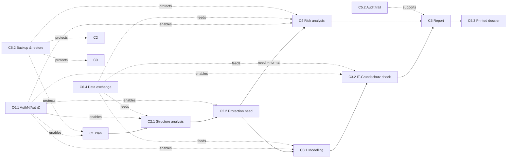
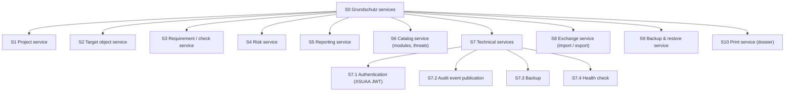
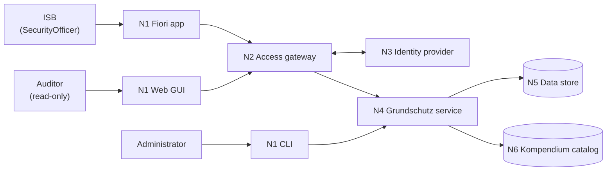
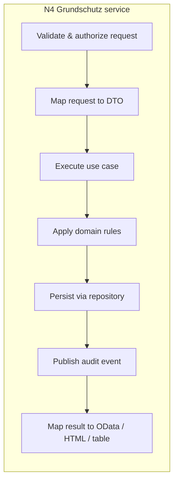
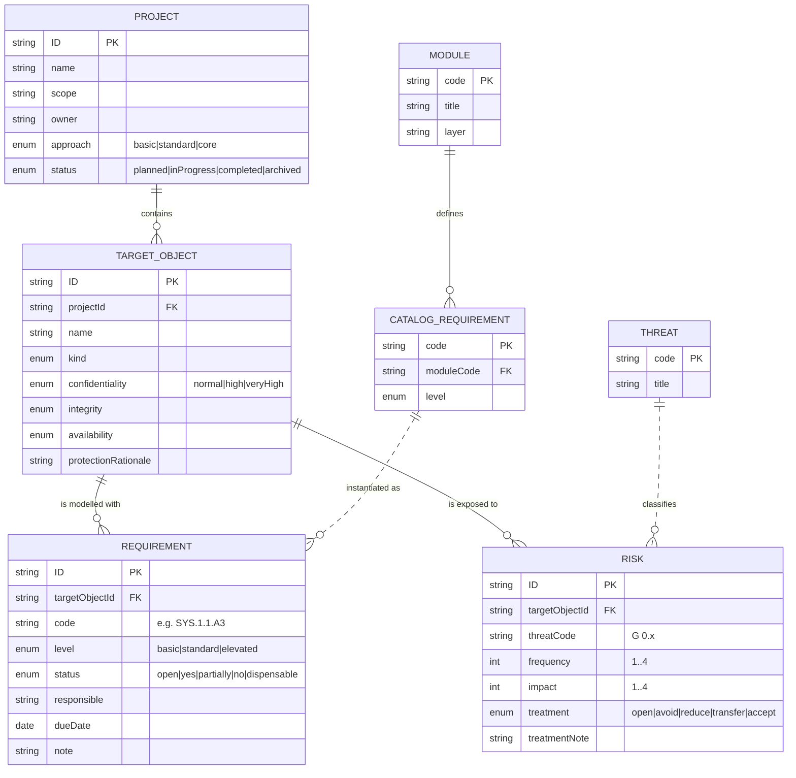
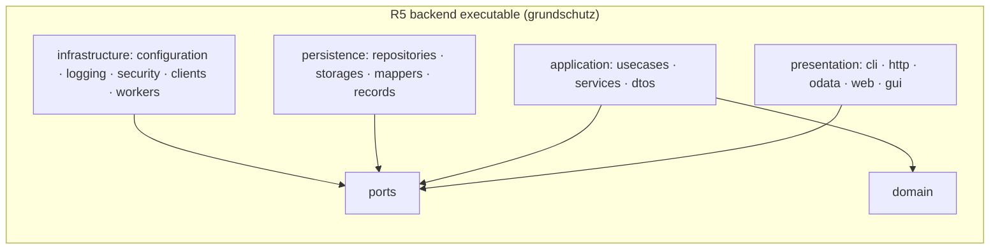
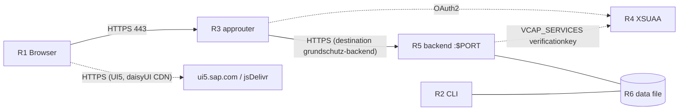

# NAF v4 Architecture Description – BSI IT-Grundschutz Project Management

This document describes the solution using the **NATO Architecture Framework v4 (NAFv4)** viewpoint
grid. It covers the Concepts (C), Service Specifications (S), Logical Specifications (L), Physical
Resource Specifications (P) and Architecture Meta-Data (A) rows. Viewpoints that add nothing for a
system of this size are marked *n/a*.

Related documents: [README.md](README.md) (setup and usage) · [uml.md](uml.md) (detailed UML).

---

## A – Architecture Meta-Data

### A1 Meta-Data Definitions

| Item | Value |
|---|---|
| Architecture name | BSI IT-Grundschutz Project Management (`grundschutz`) |
| Version / date | 1.1.0 · 2026-11-18 (adds import/export, printing, backup & restore) |
| Framework | NAFv4 (grid) with UML 2.5 / Mermaid notation |
| Architecture type | Solution architecture (as-is of the implemented system) |
| Scope | Recording, evaluating, exchanging, printing and safeguarding IT-Grundschutz security concepts. Out of scope: certification workflow, document management, a full Kompendium import |
| Owner | Information security officer (ISB) of the organisation using the tool |

### A2 Architecture Products

| Viewpoint | Section | Detailed in |
|---|---|---|
| C1, C2, C3, C4, C7 | Concepts | this document |
| S1, S3, S4 | Services | this document, OData `$metadata` |
| L1, L2, L3, L4, L7, L8 | Logical | this document, uml.md §2–§11 |
| P1, P2, P3, P4 | Physical | this document, uml.md §12, `mta.yaml` |

### A7 Standards (Ar)

| Area | Standard |
|---|---|
| Methodology | BSI-Standard 200-1 (ISMS), **200-2** (IT-Grundschutz methodology), **200-3** (risk analysis), IT-Grundschutz-Kompendium (Edition 2023, excerpt) |
| Interfaces | OASIS **OData v4.0** (JSON format, CSDL XML), HTTP/1.1, JSON (RFC 8259), **CSV (RFC 4180)**, UTF-8 |
| Integrity | SHA-256 (FIPS 180-4) checksum over canonical JSON for backups |
| Security | OAuth 2.0, JWT (RFC 7519) with RS256 (RFC 7518), SAP XSUAA |
| UI | SAP Fiori 3 design (`sap_fiori_3` theme, UI5 1.120), WCAG-conformant UI5 controls |
| Platform | SAP BTP Cloud Foundry, MTA 3.3 |
| Implementation | D language (DMD/LDC), vibe.d 0.10.3, Diet templates |

---

## C – Concepts

### C1 Capability Taxonomy

```mermaid
flowchart TD
  C0["C0 Manage information security per IT-Grundschutz"]
  C0 --> C1["C1 Plan security concept<br/>(project, scope, approach)"]
  C0 --> C2["C2 Analyse the information domain"]
  C0 --> C3["C3 Model & check security requirements"]
  C0 --> C4["C4 Analyse & treat risks"]
  C0 --> C5["C5 Report & evidence"]
  C0 --> C6["C6 Operate securely"]
  C2 --> C21["C2.1 Structure analysis"]
  C2 --> C22["C2.2 Protection-need assessment (maximum principle)"]
  C3 --> C31["C3.1 Modelling with Kompendium modules"]
  C3 --> C32["C3.2 IT-Grundschutz check"]
  C4 --> C41["C4.1 Threat identification (G 0.1–G 0.47)"]
  C4 --> C42["C4.2 Risk classification (4×4 matrix)"]
  C4 --> C43["C4.3 Risk treatment decision"]
  C5 --> C51["C5.1 Degree of fulfilment"]
  C5 --> C52["C5.2 Audit trail"]
  C5 --> C53["C5.3 Printed security concept (dossier)"]
  C6 --> C61["C6.1 Authentication & authorization"]
  C6 --> C62["C6.2 Backup & restore of the complete data set"]
  C6 --> C63["C6.3 Multi-channel access (Fiori, web, desktop, CLI, API)"]
  C6 --> C64["C6.4 Data exchange (entity & project import/export)"]
```

### C2 Enterprise Vision

| Element | Description |
|---|---|
| Vision | Every organisation can keep its IT-Grundschutz security concept consistent, traceable and current, without spreadsheets. |
| Goals | G1: enforce the BSI rules (justification duties, basic requirements, risk acceptance). G2: show the security status at any time (degree of fulfilment, open basic requirements, high risks). G3: let ISB, administrators and auditors use the same data through the channel each prefers. G4: run in the SAP BTP landscape with central identity (XSUAA). G5: exchange data with spreadsheets and other installations without breaking rules or references. G6: never lose the security documentation (verifiable backups, safe restore). G7: produce a signable, printed security concept. |
| Effects | Fewer audit findings caused by inconsistent documentation; faster IT-Grundschutz checks; risk-acceptance decisions that can be proven; bulk maintenance in Excel; project templates; documentation that can be recovered at any time. |

### C3 Capability Dependencies

### C4 Standard Processes

| Process | Capability | Supported by |
|---|---|---|
| P-1 Initiate security process | C1 | create project, choose approach |
| P-2 Structure analysis | C2.1 | target objects (9 kinds) |
| P-3 Protection-need assessment | C2.2 | C/I/A per target object, rationale, aggregation |
| P-4 Modelling | C3.1 | `ApplyModule` action, `requirement apply` CLI, web form |
| P-5 IT-Grundschutz check | C3.2 | requirement status, who is responsible, due date |
| P-6 Risk analysis | C4 | risks per target object, matrix, treatment |
| P-7 Reporting / management report | C5 | `GetProjectReport`, report tab, `report` CLI |
| P-8 Maintenance / re-assessment | C1–C5 | status transitions (reopen), PATCH of all attributes |
| P-9 Bulk maintenance in a spreadsheet | C6.4 | CSV export → edit in Excel → import (`upsert`, dry run) |
| P-10 Template / transfer of a project | C6.4 | project export, project import as a copy (`newIds`) or with the same IDs |
| P-11 Approval of the security concept | C5.3 | print dossier → sign-off by ISB and management |
| P-12 Backup & recovery (CON.3) | C6.2 | periodic and manual backups, retention, validated restore with safety backup |

### C7 Performance Parameters

| Measure | Definition | Source |
|---|---|---|
| Degree of fulfilment | (yes + dispensable + ½ partially) / relevant requirements | `ComplianceSummary.degree` |
| Basic protection achieved | all relevant basic requirements are yes or dispensable | `basicProtectionAchieved` |
| Open basic requirements | count of basic requirements not fulfilled | `basicRequirementsOpen` |
| Risk exposure | number of high and very high risks; number of untreated risks | `risksHigh`, `risksVeryHigh`, `risksUntreated` |
| Risk-analysis backlog | target objects with protection need above normal | `objectsRequiringRiskAnalysis` |
| Import quality | rows created / updated / skipped / failed per import | `ImportReport` |
| Recovery readiness | age and number of server-side backups, retention | `listBackups`, `backupRetention` |

C5 (Effects), C6 (Capability Roadmap) and C8 (Planning Assumptions): *n/a* for this as-is description.

---

## S – Service Specifications

### S1 Service Taxonomy

### S3 Service Interfaces

| Service | Provided interface (port) | Channel / protocol |
|---|---|---|
| S1 Project | `IProjectUseCases` | OData `Projects`; web `/web/projects`; CLI `project` |
| S2 Target object | `ITargetObjectUseCases` | OData `TargetObjects`, `Projects('…')/targetObjects`; web; CLI `object` |
| S3 Requirement | `IRequirementUseCases` | OData `Requirements`, action `ApplyModule`; web; CLI `requirement` |
| S4 Risk | `IRiskUseCases` | OData `Risks`, `…/risks`; web; CLI `risk` |
| S5 Reporting | `IReportUseCases` | OData function `GetProjectReport`; web report tab; CLI `report` |
| S6 Catalog | `ICatalogService` | OData `Modules`, `Threats`; web `/web/catalog`; CLI `catalog` |
| S7.1 Authentication | `DAuthGuard` | HTTP `Authorization: Bearer` |
| S7.2 Audit | `IDomainEventPublisher` | log stream (`[audit]`) |
| S7.3 Backup | `DBackupWorker` | timer, CLI `backup` |
| S7.4 Health | `/health` | HTTP JSON |
| S8 Exchange | `IExchangeService` | `/api/export/{entity}`, `/api/import/{entity}`, `/api/projects/{id}/export`, `/api/projects/import`; web `/web/admin`; Fiori table buttons; CLI `export`, `import`, `project export/import` |
| S9 Backup & restore | `IBackupService` | `/api/backup`, `/api/restore`, `/api/backups[/{name}[/restore]]`; web `/web/admin`; CLI `backup`, `restore` |
| S10 Print | `IReportUseCases.dossier` | web `/web/projects/{id}/print`; Fiori *Print*; CLI `project print` (Markdown/HTML) |

### S4 Service Functions

| Function | Pre-condition | Post-condition / rule |
|---|---|---|
| createProject | name present | status = planned |
| changeStatus | allowed transition | archived → read-only |
| createTargetObject | project exists and is writable | need above normal ⇒ rationale |
| applyModule | target object writable, module exists | missing requirements created with status open (idempotent) |
| recordStatus | – | *no* / *dispensable* ⇒ justification; basic requirement ≠ *dispensable* |
| createRisk / decideTreatment | target object writable, frequency and impact 1–4 | accepting a high or very high risk ⇒ justification |
| projectReport | project exists | aggregated need, compliance and risk figures |
| exportEntities | entity known; format json or csv | complete list (optionally one project); CSV cells protected against formula injection |
| importEntities | entity importable; mode create, upsert or skip | all rows imported through the use cases in **one transaction**, otherwise none; dry run never writes |
| exportProject / importProject | project exists / bundle valid | copy with new IDs or transfer with the same IDs; status applied last |
| dossier | project exists | report, objects, requirements, risks, catalog edition for printing |
| createBackup | – | complete data set + metadata + SHA-256 checksum |
| restore | Admin; backup valid (format, version, checksum, records, references) | safety backup written, then data set replaced atomically; dry run validates only |

S2 (Service Structure), S5 (States), S6 (Interactions), S7 (Provision), S8 (Policy): covered by L8 and uml.md §9–§10; otherwise *n/a*.

---

## L – Logical Specifications

### L1 Node Types

| Logical node | Responsibility |
|---|---|
| N1 User agent | Fiori app, web GUI, desktop webview, shell |
| N2 Access gateway | authentication, CSRF protection, routing, static content (approuter) |
| N3 Identity provider | issues tokens and scopes (XSUAA) |
| N4 Grundschutz service | domain, use cases, OData / web / CLI adapters |
| N5 Data store | document storage (JSON file, replaceable) |
| N6 Reference data | IT-Grundschutz-Kompendium catalog |

### L2 Logical Scenario

### L3 Node Interactions

| From → To | Information exchanged | Protocol |
|---|---|---|
| N1 → N2 | UI resources, OData requests, form posts | HTTPS |
| N2 ↔ N3 | authorization code, access token | OAuth 2.0 |
| N2 → N4 | OData / web requests with forwarded JWT | HTTPS (CF internal route) |
| N4 → N5 | project, target object, requirement and risk records | file I/O (atomic write) |
| N4 → N6 | modules, requirements, threats | in-process call (`ICatalogGateway`) |
| N1 (CLI) → N4 | commands, arguments | process invocation |

### L4 Logical Activities

### L5 Logical States

See uml.md §9 (project status) and §10 (requirement implementation status).

### L7 Logical Data Model

Derived (computed) attributes: `TargetObject.protectionLevel` and `requiresRiskAnalysis`,
`Requirement.moduleCode`, `Risk.level`, and every report figure.

### L8 Logical Constraints

| ID | Constraint |
|---|---|
| R1 | A protection need above *normal* requires a rationale. |
| R2 | The protection need of the information domain is the component-wise maximum of its target objects (maximum principle). |
| R3 | Target objects with a protection need above *normal* require a risk analysis. |
| R4 | Status *no* and *dispensable* require a justification. |
| R5 | Basic requirements cannot be *dispensable*. |
| R6 | Relevant requirements: Basis-Absicherung = basic; Standard = basic + standard; Kern = all. |
| R7 | Risk level = matrix(frequency, impact) per BSI 200-3. |
| R8 | Accepting a *high* or *very high* risk requires a justification. |
| R9 | Archived projects are read-only; status transitions follow uml.md §9. |
| R10 | Applying a module is idempotent: no duplicate requirement codes per target object. |
| R11 | Reads need scope Viewer, changes need Editor, deleting a project needs Admin. |
| R12 | Imports are all-or-nothing and subject to R1–R10. |
| R13 | Imports with a project scope assign target objects to that project; requirements and risks must belong to it. |
| R14 | A restore changes nothing unless format, version, checksum, every record and every reference are valid. |
| R15 | Every restore is preceded by a safety backup of the current state. |
| R16 | Backup, restore and backup downloads need scope Admin; imports need Editor; exports need Viewer. |
| R17 | Without authentication, writing requests from foreign origins are rejected (local CSRF protection). |

L6 (Logical Sequence): see uml.md §6–§8.

---

## P – Physical Resource Specifications

### P1 Resource Types

| Resource type | Realises logical node | Technology |
|---|---|---|
| R1 Browser / webview | N1 | any modern browser; Chromium `--app` window for `grundschutz gui` |
| R2 CLI executable | N1, N4 | `grundschutz` (same binary as the server) |
| R3 Approuter app | N2 | `@sap/approuter` on Node.js (CF `approuter.nodejs`) |
| R4 XSUAA service | N3 | SAP BTP XSUAA, plan `application` |
| R5 Backend app | N4 | D / vibe.d 0.10.3 executable, CF `binary_buildpack` |
| R6 Data file | N5 | JSON file `data/grundschutz.json` plus backups |
| R7 Built-in catalog | N6 | compiled into R5 (`DBuiltinCatalogClient`) |
| R9 Backup files | N5 | JSON documents in `backupDir` |
| R8 Fiori content | N1 | UI5 1.120 app, deployed into the approuter's `resources/` |

### P2 Resource Structure

### P3 Resource Connectivity

Local mode: R1 or the webview connects directly to R5 on `127.0.0.1:8080`, without R3 or R4.

### P4 Resource Functions

| Resource | Functions |
|---|---|
| R3 | login and logout, session handling, CSRF for `/odata`, scope check `Viewer`, forwarding the JWT, serving R8 |
| R5 / odata | `$metadata`, CRUD, navigation, `$filter`/`$orderby`/`$top`/`$skip`/`$count`/`$select`, `ApplyModule`, `GetProjectReport` |
| R5 / web | server-side rendered GUI, per-user CSRF token, PRG pattern |
| R5 / cli | administrative and batch commands, JSON output for scripting |
| R5 / security | RS256 JWT verification (OpenSSL), scope mapping |
| R5 / workers | periodic backup of R6 (Datensicherung, CON.3) |
| R5 / logging | audit trail of all domain events |
| R5 / exchange | CSV/JSON export and import of every entity, project bundles, transactional import |
| R5 / print | A4 HTML dossier (web), Markdown/HTML (CLI) |
| R5 / backup | complete backups with checksum, validated restore, retention, safety backup |
| R9 Backup directory | timestamped backup files `grundschutz-backup-*.json` (copy off the container via `GET /api/backup`) |

P5–P8 (states, sequences, constraints, configuration management): see uml.md §12, `mta.yaml`,
`backend/config/default.json` and the configuration table in README.md.

---

## Traceability: capability → service → logical → physical

| Capability | Service | Logical node / activity | Physical resource |
|---|---|---|---|
| C1 Plan | S1 | N4 · A3–A5 | R5 (odata, web, cli) |
| C2.1 / C2.2 | S2 | N4 · R1–R3 | R5 |
| C3.1 / C3.2 | S3, S6 | N4, N6 · R4–R6, R10 | R5, R7 |
| C4 | S4, S6 | N4, N6 · R7, R8 | R5, R7 |
| C5.1 | S5 | N4 | R5 |
| C5.2 | S7.2 | N4 · A6 | R5 (logging) |
| C6.1 | S7.1 | N2, N3 · R11 | R3, R4, R5 (security) |
| C6.2 (periodic) | S7.3 | N5 | R5 (workers), R6, R9 |
| C6.3 | S1–S6 | N1 | R1, R2, R8 |
| C5.3 Printed dossier | S10 | N4 | R5 (print), R1 |
| C6.4 Data exchange | S8 | N4 · R12, R13 | R5 (exchange), R1, R2 |
| C6.2 Backup & restore | S9 | N4, N5 · R14–R16 | R5 (backup), R6, R9 |
