# UML – BSI IT-Grundschutz

UML views of the solution described in [README.md](README.md). All diagrams use Mermaid.
Module paths are relative to `backend/source/uim/myfiori/`.

1. [Component diagram (hexagonal architecture)](#1-component-diagram-hexagonal-architecture)
2. [Domain class diagram](#2-domain-class-diagram)
3. [Ports & adapters class diagram](#3-ports--adapters-class-diagram)
4. [Application layer & DTOs](#4-application-layer--dtos)
5. [Presentation adapters](#5-presentation-adapters)
6. [Sequence: apply a module via OData (Fiori)](#6-sequence-apply-a-module-via-odata-fiori)
7. [Sequence: authenticated request through the approuter](#7-sequence-authenticated-request-through-the-approuter)
8. [Sequence: CLI command](#8-sequence-cli-command)
9. [State machine: project status](#9-state-machine-project-status)
10. [State machine: requirement implementation status](#10-state-machine-requirement-implementation-status)
11. [Activity: Grundschutz methodology supported by the tool](#11-activity-grundschutz-methodology-supported-by-the-tool)
12. [Deployment diagram](#12-deployment-diagram)
13. [Frontend (UI5) structure](#13-frontend-ui5-structure)
14. [Import / export & backup – class diagram](#14-import--export--backup--class-diagram)
15. [Sequence: transactional CSV import](#15-sequence-transactional-csv-import)
16. [Sequence: project import as a copy](#16-sequence-project-import-as-a-copy)
17. [Sequence: validated restore](#17-sequence-validated-restore)
18. [Activity: restore decision flow](#18-activity-restore-decision-flow)
19. [Sequence: print a project](#19-sequence-print-a-project)

---

## 1. Component diagram (hexagonal architecture)

Dependencies point inwards only. `bootstrap.d` is the only module that knows the concrete adapters.

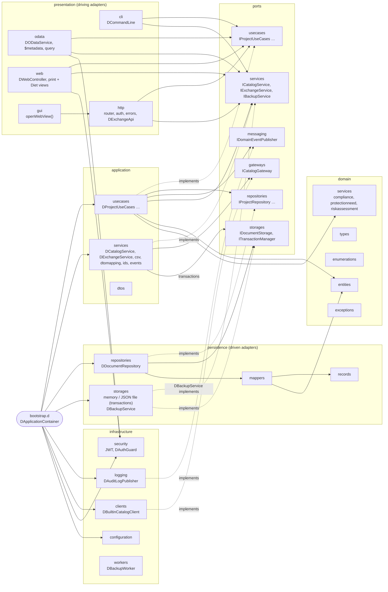

---

## 2. Domain class diagram

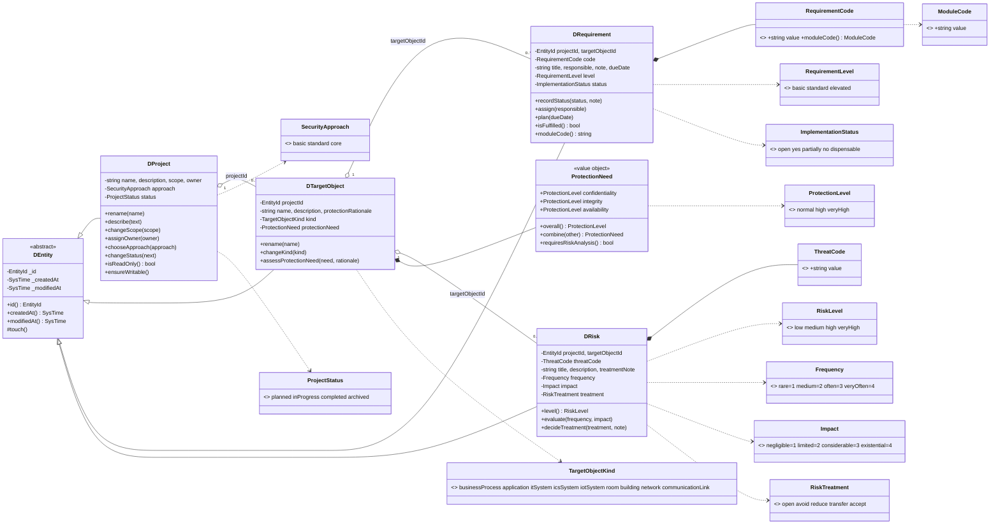

### Domain services and exceptions

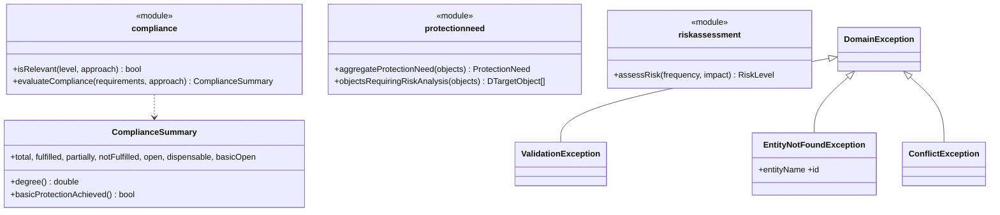

Risk matrix (BSI-Standard 200-3, implemented in `assessRisk`):

| Impact \ Frequency | rare (1) | medium (2) | often (3) | very often (4) |
|---|---|---|---|---|
| existential (4) | low | high | very high | very high |
| considerable (3) | low | medium | high | very high |
| limited (2) | low | low | medium | high |
| negligible (1) | low | low | low | low |

---

## 3. Ports & adapters class diagram

```mermaid
classDiagram
  direction TB
  class IRepository~T~ {
    <<interface>>
    +findAll() T[]
    +findById(id) T
    +save(entity)
    +remove(id) bool
  }
  class IProjectRepository { <<interface>> }
  class ITargetObjectRepository { <<interface>> +findByProject(id) }
  class IRequirementRepository { <<interface>> +findByProject(id) +findByTargetObject(id) }
  class IRiskRepository { <<interface>> +findByProject(id) +findByTargetObject(id) }
  IRepository <|-- IProjectRepository
  IRepository <|-- ITargetObjectRepository
  IRepository <|-- IRequirementRepository
  IRepository <|-- IRiskRepository

  class IDocumentStorage {
    <<interface>>
    +all(collection) Json[]
    +get(collection, id) Json
    +put(collection, id, doc)
    +remove(collection, id) bool
    +flush()
    +describe() string
    +snapshot() StorageSnapshot
    +replaceAll(StorageSnapshot)
  }
  class ITransactionManager {
    <<interface>>
    +begin()
    +commit()
    +rollback()
    +inTransaction() bool
  }
  class IDomainEventPublisher { <<interface>> +publish(DomainEvent) }
  class ICatalogGateway { <<interface>> +modules() CatalogModule[] +threats() CatalogThreat[] +edition() string }

  class DDocumentRepository~E,R,collection~ {
    <<abstract>>
    #IDocumentStorage _storage
    #less(a, b) bool
    #where(predicate) E[]
  }
  class DProjectRepository
  class DTargetObjectRepository
  class DRequirementRepository { #less() Kompendium order }
  class DRiskRepository
  DDocumentRepository <|-- DProjectRepository
  DDocumentRepository <|-- DTargetObjectRepository
  DDocumentRepository <|-- DRequirementRepository
  DDocumentRepository <|-- DRiskRepository
  DProjectRepository ..|> IProjectRepository
  DTargetObjectRepository ..|> ITargetObjectRepository
  DRequirementRepository ..|> IRequirementRepository
  DRiskRepository ..|> IRiskRepository
  DDocumentRepository --> IDocumentStorage
  DDocumentRepository ..> mappers : toRecord / toEntity

  class DMemoryDocumentStorage { -StorageSnapshot _data -StorageSnapshot _txBackup #persist() }
  class DJsonFileDocumentStorage { -string _path +flush() atomic write, skipped inside a transaction }
  DMemoryDocumentStorage ..|> IDocumentStorage
  DMemoryDocumentStorage ..|> ITransactionManager
  DMemoryDocumentStorage <|-- DJsonFileDocumentStorage

  class DAuditLogPublisher { +recent(max) DomainEvent[] }
  DAuditLogPublisher ..|> IDomainEventPublisher
  class DBuiltinCatalogClient
  DBuiltinCatalogClient ..|> ICatalogGateway

  class mappers { <<module>> }
  class records { <<module>> ProjectRecord TargetObjectRecord RequirementRecord RiskRecord }
  mappers ..> records
```

---

## 4. Application layer & DTOs

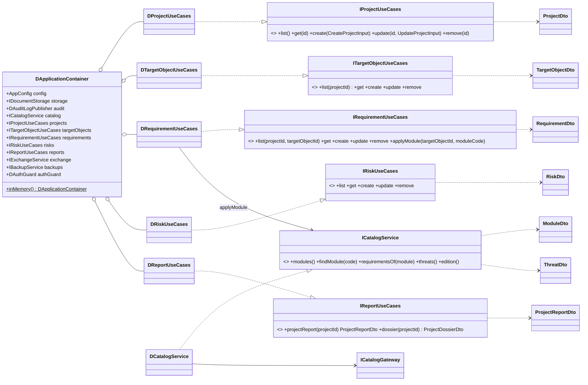

---

## 5. Presentation adapters

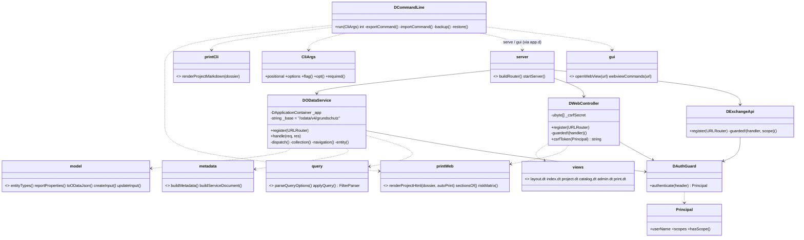

---

## 6. Sequence: apply a module via OData (Fiori)

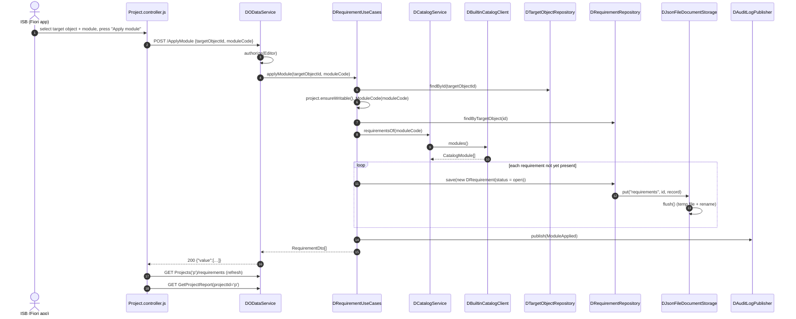

---

## 7. Sequence: authenticated request through the approuter

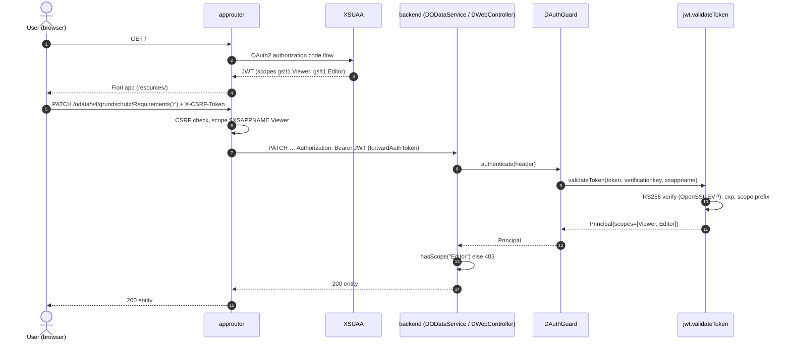

---

## 8. Sequence: CLI command

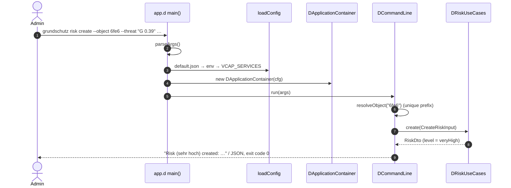

---

## 9. State machine: project status

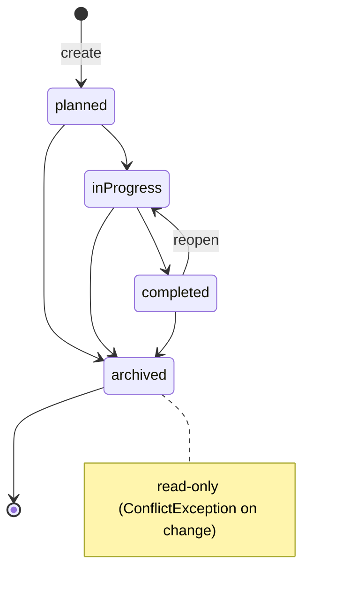

## 10. State machine: requirement implementation status

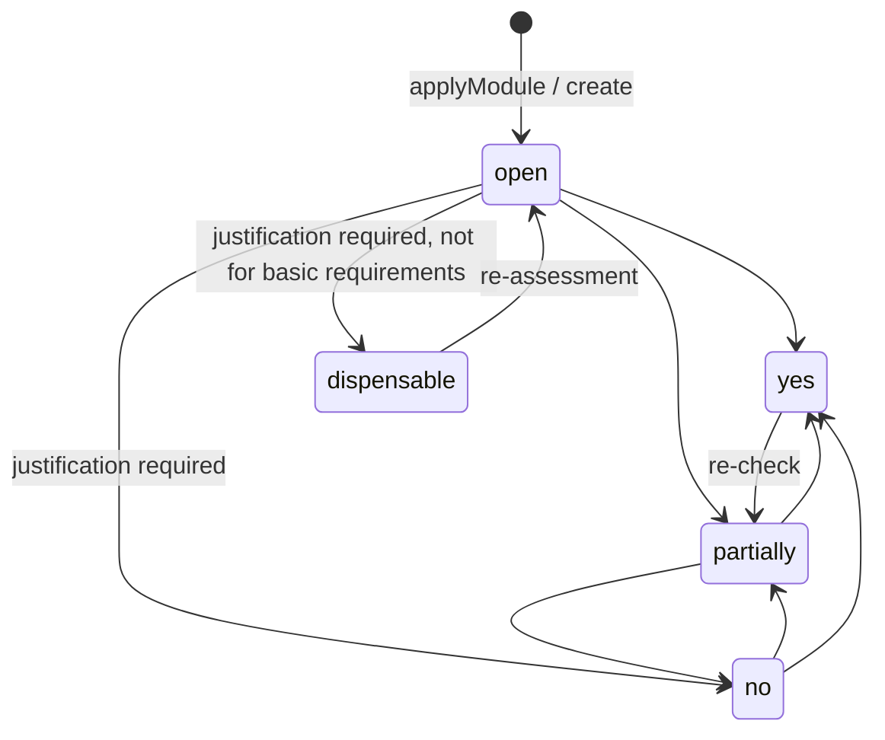

The diagram shows the typical lifecycle. The domain (`DRequirement.recordStatus`) allows any
transition and enforces only the two guards above: *no* and *dispensable* need a justification, and
basic requirements can never be *dispensable*.

---

## 11. Activity: Grundschutz methodology supported by the tool

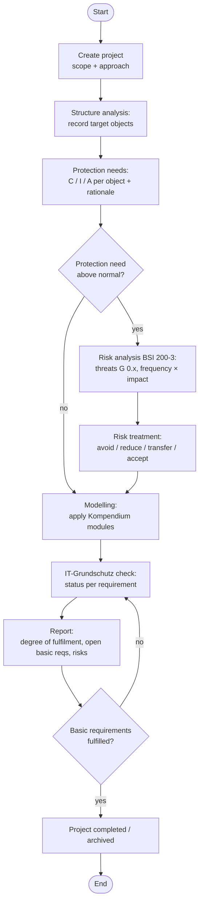

---

## 12. Deployment diagram

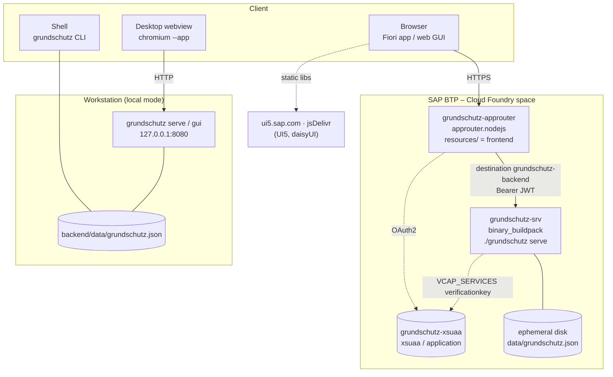

---

## 13. Frontend (UI5) structure

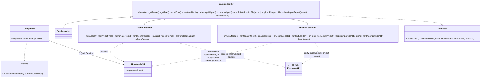

| Route | Pattern | View |
|---|---|---|
| `main` | `` | `Main.view.xml` – project list, create dialog |
| `project` | `project/{projectId}` | `Project.view.xml` – tabs: target objects, IT-Grundschutz check, risk analysis, report, master data |

---

## 14. Import / export & backup – class diagram

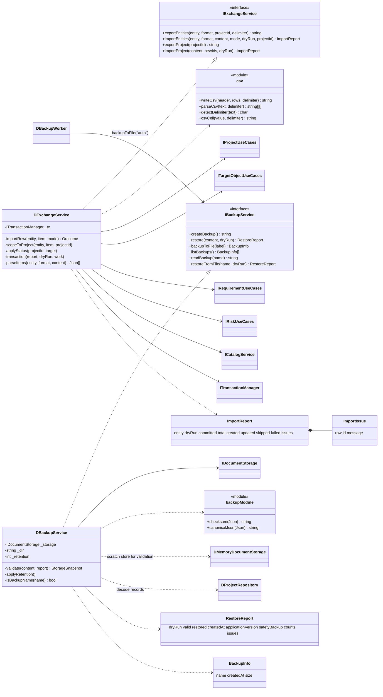

| Mode | Existing ID | New / no ID |
|---|---|---|
| `create` | row error → whole import rolled back | created (ID kept if given) |
| `upsert` | updated (only columns present) | created |
| `skip` | skipped | created |

---

## 15. Sequence: transactional CSV import

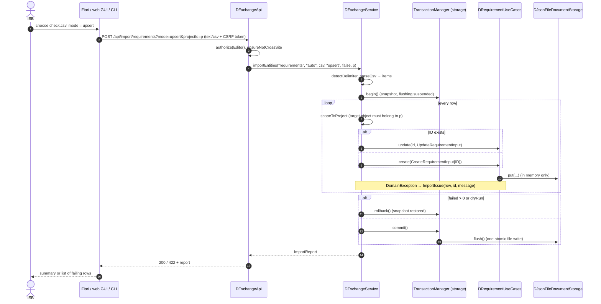

---

## 16. Sequence: project import as a copy

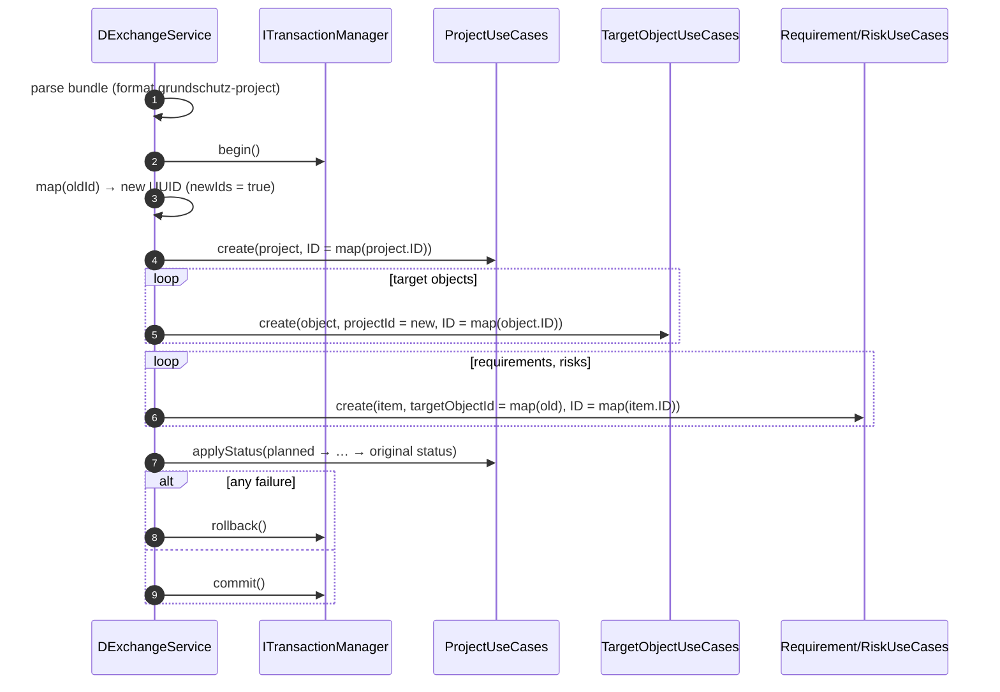

---

## 17. Sequence: validated restore

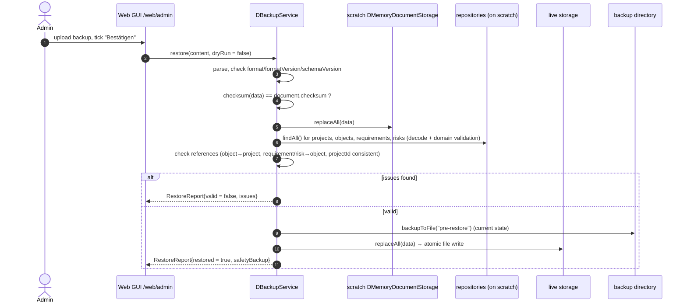

## 18. Activity: restore decision flow

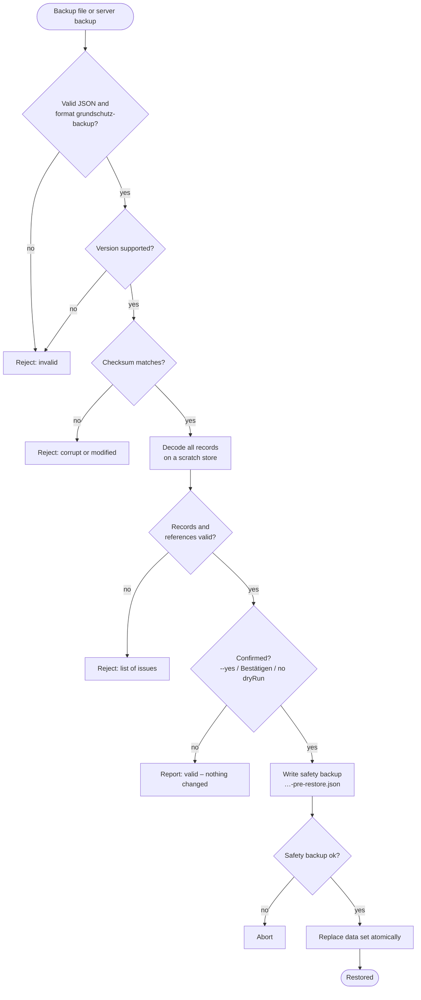

---

## 19. Sequence: print a project

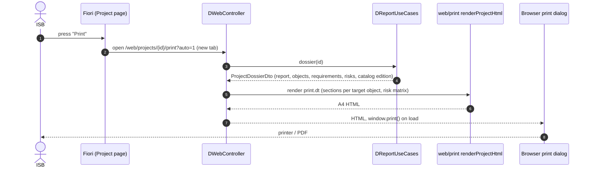

CLI: `grundschutz project print <id>` uses the same `dossier()` together with `renderProjectMarkdown`, or
`renderProjectHtml` with `--format html`.
